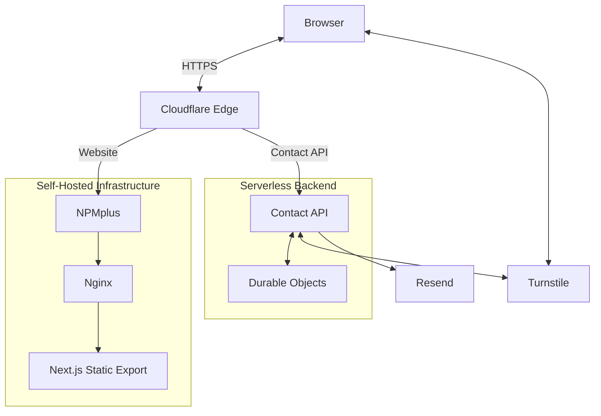
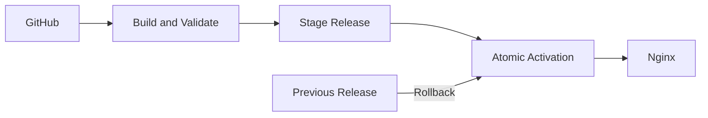

# Personal Portfolio Website

[](https://github.com/hmoobvaj-m/resume-website/actions/workflows/ci.yml)
[](https://github.com/hmoobvaj-m/resume-website/actions/workflows/codeql.yml)
[](https://github.com/hmoobvaj-m/resume-website/actions/workflows/workflow-quality.yml)
[](https://github.com/hmoobvaj-m/resume-website/actions/workflows/production-health.yml)

My personal portfolio and resume website, built with Next.js and hosted on my own infrastructure.

Beyond showcasing my professional experience and projects, I use this website to explore practical approaches to software architecture, application security, automated testing, and infrastructure management.

**[Live Website](https://matthew.hmoobvaj.us)** | **[View Resume](https://matthew.hmoobvaj.us/resume)** | **[Download Resume](https://matthew.hmoobvaj.us/resume.pdf)**

## Technology Stack

| Area | Technologies |
| --- | --- |
| Frontend | Next.js, React, TypeScript, Tailwind CSS |
| Backend | Cloudflare Workers, Durable Objects |
| Security | Cloudflare WAF, Turnstile, Content Security Policy |
| Infrastructure | Proxmox VE, Debian, Nginx, NPMplus |
| Testing | Node.js Test Runner, Miniflare, Playwright |
| Automation | GitHub Actions, Dependabot, systemd |
| Email | Resend |

## Architecture

The website separates static content delivery from backend request processing. The frontend is self-hosted, while contact form submissions are handled through Cloudflare Workers.



### Design Decisions

- **Static export:** Removes the need for a continuously running Node.js application server.
- **Serverless backend:** Keeps public API processing separate from my hosting infrastructure.
- **Durable Objects:** Provides coordinated, persistent rate limiting across requests.
- **Self-hosting:** Gives me greater control over deployment, networking, and infrastructure.
- **Atomic deployments:** Allows new releases to be activated without partially publishing build artifacts and supports rollback.
- **Build-generated CSP:** Keeps JavaScript authorization synchronized with each production build.

## Security

Security is incorporated throughout the application rather than treated as a separate development phase.

- Document-specific SHA-256 Content Security Policies.
- Server-side Turnstile verification and input validation.
- Per-client and shared email-sending rate limits.
- Fail-closed behavior when required security services are unavailable.
- HTTP security headers and Cloudflare edge protection.
- Unprivileged deployments with systemd sandboxing.
- Frozen dependency installations and SHA-pinned GitHub Actions.

## Testing and Automation

The project uses automated testing to catch regressions without introducing unnecessary development overhead.

| Tool | Purpose |
| --- | --- |
| Node.js Test Runner | Unit and security regression testing |
| Miniflare | Cloudflare Worker and Durable Object integration testing |
| Playwright | Desktop and mobile browser regression testing |
| ESLint and TypeScript | Code quality and type checking |
| CodeQL | Static application security analysis |
| Actionlint and Zizmor | Workflow validation and security analysis |
| Dependabot | Automated dependency maintenance |

Scheduled production health checks verify public endpoint availability, security headers, and resume PDF delivery.

## Deployment

The frontend is deployed through a systemd-managed service running on my self-hosted Linux infrastructure.



Deployments use change detection, isolated release directories, shared static assets, and release retention. The contact API is deployed independently through Cloudflare Workers.

## Local Development

**Prerequisites:** Node.js 24.22.3 and pnpm 10.34.9.

```bash
git clone https://github.com/hmoobvaj-m/resume-website.git
cd resume-website
pnpm install --frozen-lockfile
```

Create a `.env.local` file with Cloudflare's public testing site key:

```dotenv
NEXT_PUBLIC_TURNSTILE_SITE_KEY=1x00000000000000000000AA
```

Start the development server:

```bash
pnpm dev
```

Visit [http://localhost:3000](http://localhost:3000).

The local frontend does not include a running contact API. Automated browser tests mock the required backend responses.

### Development Commands

| Command | Description |
| --- | --- |
| `pnpm dev` | Start development server |
| `pnpm build` | Generate static export and CSP |
| `pnpm lint` | Run ESLint |
| `pnpm exec tsc --noEmit` | Check TypeScript |
| `pnpm test` | Run backend and CSP tests |
| `pnpm test:e2e` | Run browser regression tests |
| `pnpm serve:test` | Preview production build |
| `pnpm audit` | Audit dependencies |

Before running browser tests:

```bash
pnpm exec playwright install chromium
pnpm build
pnpm test:e2e
```

## Repository Structure

```text
resume-website/
├── .github/       # CI workflows and dependency management
├── public/        # Static assets
├── scripts/       # Security and monitoring utilities
├── src/           # Frontend components, routes, and content
├── tests/         # Unit, integration, and browser tests
└── workers/       # Contact API and rate-limiting services
```

---

Designed, developed, and maintained as a personal software engineering project.